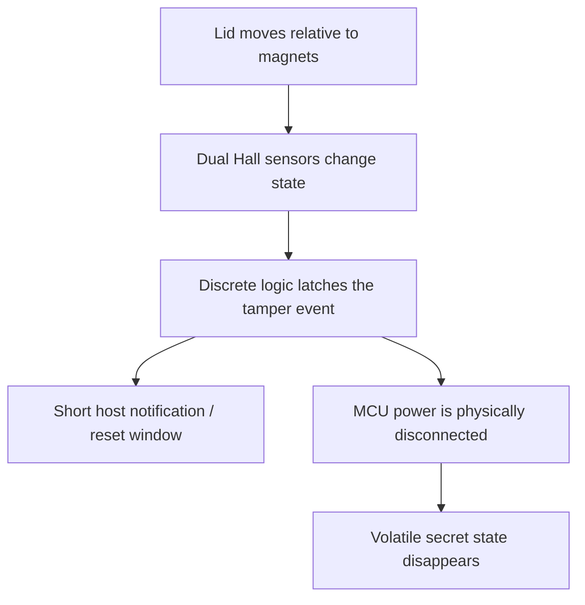

<p align="center">
 
</p>

<h1 align="center">FailDeadly</h1>

<p align="center">
  <strong>Fail secure. Fail deadly.</strong><br> 
   A tamper-responsive USB root-of-trust prototype for servers without a suitable hardware trust anchor.
</p>

<p align="center"> 
  <a href="hardware/FailDeadly/LICENSE"></a> 
  <a href="firmware/LICENSE"></a> 
   
</p>


## What is FailDeadly?

FailDeadly is an open hardware security device designed to make selected server secrets physically ephemeral. It keeps key material in MCU SRAM and monitors the server enclosure with Hall-effect sensors. When the expected magnetic field changes, a hardware-controlled path first provides the device with a short window to signal the host, then removes power from the MCU. Once SRAM loses power, the secret is gone.

The project began as a practical response to older servers where TPM 2.0 was unavailable. It is not intended to emulate every TPM feature. Instead, it explores a narrower security property: tying access to a secret to the machine's continued physical integrity.

> [!WARNING]
> FailDeadly deliberately values confidentiality over availability. Tampering, sensor failure, power-system failure, or a false positive may permanently destroy volatile key material. The project is experimental, has not been independently audited, and must not be treated as production-ready security hardware, _yet_.

## Security model

The central design rule is that firmware must not be able to cancel the final tamper response.


	
The supercapacitor is there to preserve SRAM during ordinary power loss. It does not defeat the tamper path: the power-isolation circuit disconnects the MCU from both USB power and stored energy after the response delay.

## Intended protections
* Detect opening or displacement of a monitored server lid.
* Prevent key material from remaining recoverable in non-volatile MCU storage.
* Make the terminal power-cut decision in discrete hardware rather than mutable firmware.
* Allow the host to react before key destruction, using USB or an isolated reset output.
* Survive routine power outages without automatically losing the volatile trust state.

## Explicit non-goals
* Availability under tamper, component failure, or sensor misalignment.
* Resistance to invasive semiconductor attacks, decapsulation, or advanced fault injection.
* Protecting plaintext already exposed to a compromised host during an authorized operation.
* Replacing secure boot, measured boot, disk encryption, or a complete remote-attestation protocol by itself.
* Claiming production readiness or independent security certification.

## Hardware architecture

The current board is a four-layer USB device built around an STM32F401CCU6. The design includes:

* two AH180-WG-7 Hall-effect sensors for enclosure monitoring;
* a discrete latch and power-control path that remains independent of MCU decisions;
* an XLC-0820 4 V / 30 F supercapacitor for SRAM retention during power outages;
* a USB Type-A interface with ESD protection and current limiting;
* a galvanically isolated external host-reset output (optional).

The complete KiCad sources, fabrication outputs, schematic PDF, and interactive BOM are committed to this repository.

| Resource | Description |
|---|---|
| [Schematic and PCB](hardware/FailDeadly/) | Editable KiCad project and component libraries |
| [Fabrication outputs](hardware/FailDeadly/Output/) | Gerbers and drill data for revision 001 |
| [Schematic PDF](docs/FailDeadly.pdf) | Three-page rendered schematic |
| [Interactive BOM](docs/ibom.html) | Browser-based board inspection |
| [Front / back renders](hardware/README.md) | Board overview |

## Firmware architecture

The firmware is intentionally structured as a security boundary rather than a single privileged application:

* FreeRTOS MPU port: restricted tasks run unprivileged and receive explicit access to memory regions and kernel objects.
* Static allocation: RTOS tasks and communication objects are statically allocated; dynamic allocation is disabled.
* Privileged services: access to hardware CRC and other facilities is mediated by dedicated tasks.
* Bounded USB protocol: USB CDC input is processed by a length-bounded, timeout-aware framed parser with CRC-32 validation.
* Composite USB foundation: CDC and HID interfaces are configured for command transport and host-side emergency actions.
* Minimal crypto surface: TF-PSA-Crypto/mbedTLS is built with a reduced profile, currently targeting SHA-256 and secp256r1 ECDSA.
* Boot-time zeroization: the volatile crypto region is explicitly cleared during early startup.

The crypto command API is present, but key generation/import and sign/verify/encrypt/decrtypt handlers are still under development. This distinction matters: the repository currently demonstrates the isolation and communication architecture, not a finished cryptographic product.

## Repository layout

```text
.                                                                
├── hardware/        KiCad sources, local libraries, and fabrication files                                            
├── firmware/        STM32F401 firmware and PlatformIO configuration                                                  
├── docs/            Rendered schematic and interactive BOM      
└── staff/           Project logo, board renders, and source artwork  
``` 

## Build the firmware

Requirments:

* [PlatformIO Core](https://docs.platformio.org/en/latest/core/installation/index.html)
* An ARM GCC toolchain managed by PlatformIO
* ST-Link and OpenOCD for on-target debugging and/or upload

Clone the repository with its cryptographic submodule, then build:

git clone --recurse-submodules https://github.com/yvoronkin/FailDeadly.git

cd FailDeadly/firmware

pio run

Upload through ST-Link and open the serial monitor:

pio run --target upload

pio device monitor

The default PlatformIO environment uses the custom MPU-aware linker script at [firmware/linker/STM32F401CCUx\_MPU.ld](http://firmware/linker/STM32F401CCUx_MPU.ld).

## Project status

| Area | Status | Notes |
|---|---|---|
| Hardware revision 001 | Design complete | Four-layer layout is DRC-clean; KiCad sources and manufacturing outputs are available |
| Board validation | Not yet documented | Electrical and destructive tamper-response test still in verification stage |
| Firmware platform | In progress | USB, RTOS/MPU task isolation, logging, parser and hardware CRC foundation exist |
| Cryptographic operations | In progress | Minimal crypto profile and volatile storage exist; command handlers remain incomplete |
| Host tooling | Planned | Provisioning, lifecycle management, and recovery tooling |
| Vault / attestation integration | Planned | Challenge-response login and infrastructure policy integration |

Near-term work is tracked in the repository history and will focus on hardware bring-up, repeatable tamper timing measurements, completion of the crypto service, host tooling, and tests around trust-boundaty failures.

## Design rationale

FailDeadly is intentionally opinionated:

1. Secrets are volatile. There is no encrypted blob in ordinary MCU flash waiting for an offline attack.
2. Tamper response is hardware-owned. Firmware may report the event, but cannot veto the latched power cut.
3. Power loss is not automatically tamper. Stored energy keeps the volatile state alive through expected outages.
4. Compromise is contained. MPU regions, unprivileged tasks, explicit object grants, bounded messages, and a reduced crypto configuration limit the useful blast radius of a firmware bug.
5. Failure is visible and testable. The board exposes relevant signals as test points and keeps editable design sources alongside manufacturing artifacts.

These choices do not make the system unbreakable. They make its assumptions, failure mode, and trust boundaries concrete enough to analyze and test.

## Use cases under exploration.
* a physical-presence factor in server remote attestation;
* volatile custody of a LUKS unlock key or wrapping key;
* challenge signing for a Vault authentication method;
* forced host reset or emergency SysRq action following enclosure tamper;
* research and education around tamper response, embedded isolation, and fail-secure design.

## License

This repository contains multiple independently licensed components:

* hardware design files: [CERN Open Hardware License Version 2 - Strongly Reciprocal](http://hardware/FailDeadly/LICENSE)
* original firmware: [GNU General Public License Version 2](http://firmware/LICENSE);
* third-party libraries and supplied component models: their respective upstream licenses.

See the license file within each component directory before reuse or redistribution.

